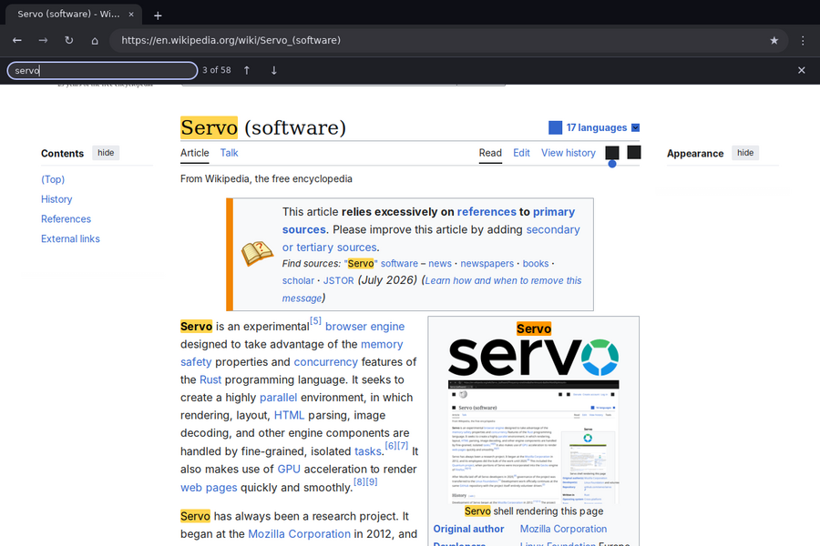
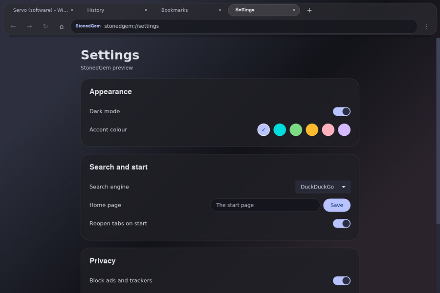
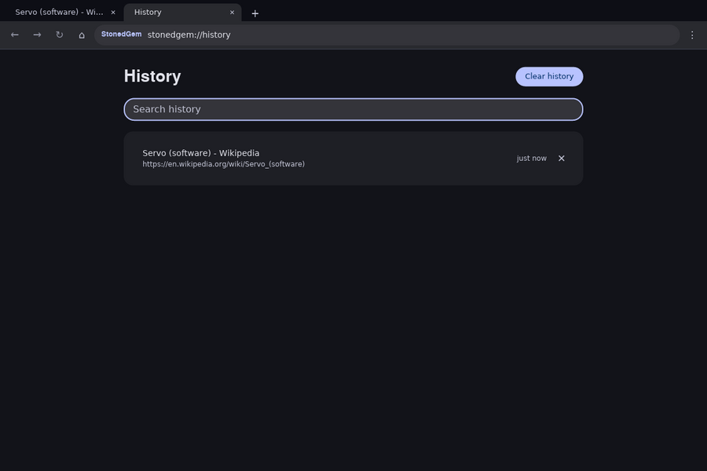

# StonedGem

A modular browser platform in Rust, without Chromium or Qt. It will be the
base of **OyNIx 5.4.0** (and later PowerOyNix): Servo for web content, Iced
for the browser window, Slint for extension windows, and a Rust extension
runtime. OyNIx moves onto it one piece at a time.

**Status:** early. What exists today is the set of engine-independent
services already moved out of OyNIx — and OyNIx uses them:

| Crate | What it does |
|---|---|
| [`stonedgem-url`](crates/stonedgem-url) | Address-bar logic: typed text → URL or search, `!bangs`, display forms, tracking-parameter removal that never touches sign-ins |
| [`stonedgem-poweroynix`](crates/stonedgem-poweroynix) | `.poweroynix` signature checking (Ed25519 over SHA3-256 file hashes) |
| [`stonedgem-vault`](crates/stonedgem-vault) | Encrypted password store, CSV import, Firefox passwords and bookmarks |
| [`stonedgem-profile`](crates/stonedgem-profile) | Profile folders (config, data, cache, filters) under the product's app name |
| [`stonedgem-blocker`](crates/stonedgem-blocker) | Content blocker: Adblock/uBlock filter lists, element hiding, the list catalogue, `network.ts` rules |
| [`stonedgem-library`](crates/stonedgem-library) | History, bookmarks (HTML import/export), reading list, recently closed tabs |
| [`stonedgem-extensions`](crates/stonedgem-extensions) | Extension packages: Chrome/Firefox MV2/MV3, `.oynix`, `.poweroynix`, TypeScript/TSX, widgets |
| [`stonedgem-chrome`](crates/stonedgem-chrome) | The browser window (Iced): tabs, address bar, menu, History, Bookmarks, Settings, find in page; `cargo run -p stonedgem-chrome` |
| [`stonedgem-zsharp`](crates/stonedgem-zsharp) | **Z#++**: Z#-compatible scripting with `.zsp` programs, `.zsx` headers, `.zsg` GPU kernels/shaders (WGSL), 2D canvas, sandbox; `zspp` tool — see [docs/ZSHARP.md](docs/ZSHARP.md) |
| [`stonedgem-theme`](crates/stonedgem-theme) | Material 3 colour schemes from one accent colour (the window's and extension themes') |
| [`stonedgem-engine`](crates/stonedgem-engine) | Servo behind StonedGem's own types, with the blocker on every request (spike; `cargo test -p stonedgem-engine`) |

The engine works (see [docs/ENGINE-SPIKE.md](docs/ENGINE-SPIKE.md)) and a browser window runs on it, with
the extension runtime: content scripts (OyNIx and Chrome/Firefox, with a first set of `chrome.*` APIs),
power extensions' `network.ts`, start-page widgets, extension pages, and extension panels in Slint
(`panel.slint`), scripted in Z#++.



| Settings | History |
|---|---|
|  |  |
Nothing is described as working until its code and tests show it.

## Documents

- [Architecture](docs/ARCHITECTURE.md) — layers, the engine decision, Iced/Slint, extensions
- [Migration plan](docs/MIGRATION.md) — how OyNIx moves over, phase by phase
- [Compatibility](docs/COMPATIBILITY.md) — what works, what's planned, what isn't supported
- [Z#++](docs/ZSHARP.md) — summary; the full docs site is built from [`docs/zsharp/`](docs/zsharp/) with `cargo run -p stonedgem-zsharp-docs`
- [GemSig plan](docs/GEMSIG-PLAN.md) — signature format 3 for `.poweroynix` (proposal)
- [The original brief](prompt.md)

## Building

```bash
cargo test --workspace
```

Rust 1.80 or newer. The vault bundles SQLite (built by the `rusqlite`
crate), so a C compiler is needed. C++ code, when it arrives, targets C++23.

`tools/poweroynix.py` makes signing keys, signs and verifies `.poweroynix`
packages; it needs only Python 3.

## Licence

MIT. Servo, when it's added, is MPL-2.0.
