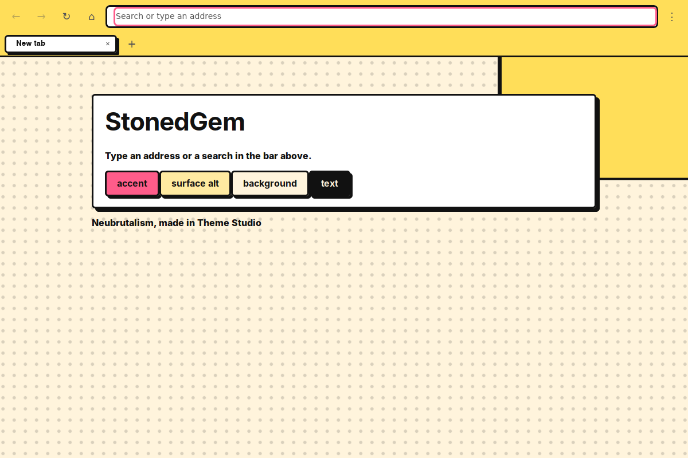

# Hyperthemes and Theme Studio


A **`.hypertheme`** restyles the whole browser: the Iced window (toolbar,
tabs, address field, cards, buttons, menus), the start page, and extension
pages. OyNIx can read the same file for its Qt chrome. It's a zip archive,
or a folder while you work on it, holding `hypertheme.toml` and any of
these parts:

| File | Language | What it gives |
|---|---|---|
| `tokens.json` | JSON | colour and number tokens; `"panels"`; `"dark"` overrides |
| `style.rs` | basic Rust | `pub const NAME: Type = value;` constants and `pub mod dark { … }`. It's parsed, never compiled. |
| `theme.zsp` | Z#++ | `func tokens(dark)` returns a map of tokens |
| `theme.zxx` | Zsharpend | `fn tokens(dark)` returns a map of tokens |
| `iced.toml` | TOML | the window's panels: `[card] fill = "#fff" shadow_x = 6`, plus `[dark.card]` |
| `pages.css` | CSS | extra rules for the start page and extension pages |
| `start.tsx` | TSX | the start page, `export default function Start()`, with `theme` and `oynix` as globals |
| `chrome.qml` | QML | OyNIx's `Theme` override; StonedGem carries it but doesn't read it |
| `background.zsg` | Z#++ shader | `fragment background(uv: vec2) -> color`, drawn behind the start page |
| `graph.json` | JSON | the Theme Studio graph it was made from |

```toml
# hypertheme.toml
[hypertheme]
name = "Neubrutalism"
version = "1.0.0"
author = "StonedGem"
description = "Cream paper, loud colour, thick ink borders and hard offset shadows."
modes = "both"        # light, dark or both
```

## Tokens

| Kind | Tokens |
|---|---|
| Colours (`#rrggbb`) | `background` `surface` `surface_alt` `text` `muted` `accent` `on_accent` `border` `danger` `shadow` |
| Numbers (px) | `radius` `border_width` `shadow_x` `shadow_y` `shadow_blur`, and `font_weight` |
| Others | `glass` (true: Liquid Glass panels; false: flat, opaque ones), `font_family` |

**Panels** (`toolbar` `tab` `card` `button` `field` `popup`) each take
`fill` `text` `border` `radius` `border_width` `shadow_x` `shadow_y`.

Parts are merged in the table's order (`tokens.json`, `style.rs`,
`theme.zsp`, `theme.zxx`, `iced.toml`), and later parts win. In dark mode
each part's `dark` overrides are applied next. Anything still missing gets
a default worked out from the tokens that are set, and low contrast (text
on background, muted text, text on the accent) is reported as a warning.
The theme programs run in the Z#++ and Zsharpend sandboxes, with a 500 ms
limit.

Every part is checked when a theme is installed: JSON, TOML and Rust are
parsed, the programs and shader are compiled, and the TSX is transpiled. A
broken theme is refused with the file and line.

In the window, the tokens become the palette:

| Token | Used for |
|---|---|
| `background` | the window |
| `surface` / `surface_alt` | containers and raised controls |
| `accent` / `on_accent` | primary buttons, focus rings and selection |
| `radius` | rounding, scaled against the default 16 px |
| `border_width` / `border` | every panel's edge |
| `shadow_x` / `shadow_y` / `shadow` | hard offset shadows on tabs, cards, buttons and menus |

## Using one

**Settings › Appearance › Style** lists the built-in and installed themes.
The **Install** field takes a `.hypertheme` file or folder. Installed
themes live in the profile's `hyperthemes/` folder.

## Theme Studio

**Settings › Appearance › Open Theme Studio** (or Theme Studio in the menu)
opens a full-page node editor. It's a built-in **power extension**: its page
(`extra.html`) talks to its **Zsharpend** script (`script.zxx`) through
`chrome.runtime.sendMessage`.

- **Nodes:**
  - Colour, HSL, Mix, Shade, Readable (black or white, whichever reads better on the colour wired in)
  - Number, Font
  - Shader: `.zsg` code, previewed by the shader renderer
  - Panel
  - Theme: one in light mode; an optional second one in dark mode overrides it
- **Wires:** drag from an output dot to an input of the same type. Click a wire to remove it. Wires are drawn on a canvas used as the board's background, because Servo paints SVG and canvas elements above later siblings.
- **Live preview:** a small browser drawn with the CSS the browser would generate. On every change, the script turns the graph into all the parts and the browser resolves them.
- **Parts:** open any generated file to read it. **Save** writes the theme to the profile. **Save and use** applies it at once.

The script gets these power-extension functions (see
`stonedgem_extensions::zscript::POWER_API`):

- `to_json`, `from_json`
- `zsg_preview(code, w, h)`
- `hypertheme_resolve(files, dark)`
- `hypertheme_save(name, files)`
- `hypertheme_apply(file)`
- `hypertheme_list()`

## Neubrutalism

| Start page | Settings, dark |
|---|---|
|  |  |

The built-in **Neubrutalism** theme was made in Theme Studio:

- cream paper (`#fff4dc`) and ink (`#111111`) with pink, yellow and cyan;
- 3 px borders, 4 px hard shadows (6 px on cards and menus) and 6 px corners;
- heavy type and a dot-grid backdrop shader;
- a dark mode that keeps the loud buttons on zinc.

Its `graph.json` is the source. The other parts are what the Studio's
script generates from it, and `cargo test -p stonedgem-hypertheme --test
studio` checks that they still match. After changing the script or the
graph, run that command with `REGENERATE=1` to rewrite them.
